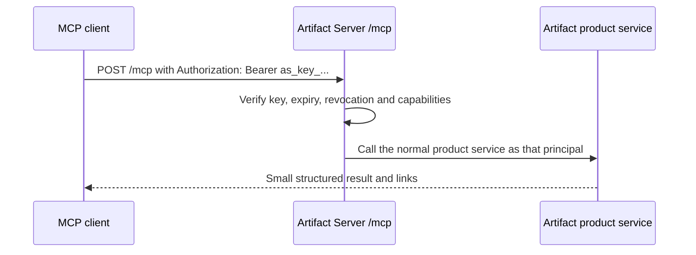

# Artifact Server MCP baseline

**Status:** Approved engineering baseline
**Date:** August 14, 2026
**Protocol target:** MCP `2026-07-28`, with stateless 2025-era client compatibility

## Decision

Artifact Server exposes one MCP control endpoint at `POST /mcp`. It uses the same artifact, version, permission, and comparison services as the browser application and normal HTTP API. MCP does not implement a second copy of product logic.

Large website and file bytes do not travel inside MCP messages. MCP starts an upload, returns short-lived upload instructions, and later commits the uploaded files as an immutable version.

Authentication is by managed Artifact Server API key (`as_key_...`) only. MCP has no OAuth: no protected-resource metadata, no authorization-server metadata, and no access tokens from an external identity provider.

| Installation | Authority |
| --- | --- |
| Private-team or self-hosted server | Administrator-issued, scoped Artifact Server API key |
| CI and automation | Service API key kept in the deployment's secret manager |
| One laptop | `artifactserver connect` and the local stdio helper, which needs no setup credential |

One standalone Artifact Server installation is one closed trust domain: one person or one team. Public self-registration is not supported.

## Official connection and authentication paths

These are product requirements. Reading a token from startup output is not a
supported onboarding path.

| Condition | Human steps | Credential handling |
| --- | --- | --- |
| Local, single user | Install Artifact Server, run `artifactserver connect`, select a client only when more than one supported client is found, then use the client. | `artifactserver connect` registers `artifactserver mcp`. The helper starts or locates the local service and handles its private local credential. The user does not sign in, create a key, copy a key, or read logs. |
| Team or self-hosted server | An administrator creates a scoped API key in the administration interface or administrator CLI. The developer adds it once through the client's secret input. | Keys never appear in startup logs, project files, command history generated by Artifact Server, or ordinary diagnostic output. |
| CI, scripts, and unattended agents | An administrator creates a service API key and places it in the deployment's secret manager. | The key identifies one service principal and carries only its granted capabilities. No browser is involved. |

Artifact viewing has a separate rule: an account-required artifact opens after
the browser signs in (API-key sign-in on a team server, the automatic owner
session on a local server); a public artifact opens without sign-in. An MCP
credential does not become a browser cookie.

### Local connection

`artifactserver connect` is the supported local onboarding command. It starts
or locates the per-user service, registers `artifactserver mcp` through the
selected client's normal local stdio configuration, verifies a real discovery
call, and prints only the selected client and local server address.

`artifactserver connect <client>` provides a non-interactive client choice.
`artifactserver disconnect <client>` removes the registration.
`artifactserver doctor` reports service, client-registration, and reachability
problems without revealing credentials.

#### Transactional client onboarding

Connect and disconnect preflight both Artifact Server's private registration
state and the selected client's current configuration before either is
changed. The CLI rejects malformed, foreign, or independently changed managed
entries. It never adopts or replaces an entry that it cannot prove it owns.

Before the first client mutation, the CLI writes a user-only transaction
journal. The journal records the exact client change, the registration state
before and after the operation, and content digests used for compare-and-swap
writes. It contains no credential. Only one journal may exist for an
installation at a time.

After interruption, the next connect or disconnect command reads the journal
before planning new work. It accepts only the exact before state, the exact
after state, or the documented native-client intermediate state produced when
replacement has removed the old entry but has not added the new entry. The CLI
then completes the operation forward. A normal command failure rolls back only
when the exact inverse client change is safe. If a durable client-file change
has already committed, the CLI keeps the journal and resumes forward instead
of reconstructing or snapshotting unrelated client configuration. If either
state changed outside the transaction, recovery stops, preserves that
independent change, and keeps the journal for explicit safe recovery. The CLI
never overwrites a state that does not match the journal.

The stdio helper is a transport bridge over the same authenticated loopback
`/mcp` endpoint used by the product. It does not define tools, implement
artifact rules, or write directly to the database. Its private local credential
is retrieved from a user-only file and never shown, placed in client
configuration, or passed as a process argument.

### Remote connection

For a team or self-hosted server:

1. An administrator creates a scoped API key and gives it to the developer through the team's normal secret channel.
2. The user adds `https://<server>/mcp` to Codex, Claude Code, or another remote MCP client and stores the key through the client's secret input.
3. The client calls `/mcp` with `Authorization: Bearer as_key_...`.
4. Artifact Server verifies the key, creates an internal principal, and applies normal product permissions.

A request without a valid key returns `401 Unauthorized` with `WWW-Authenticate: Bearer`. The response carries no metadata address, because no browser flow exists to start. The client must first be able to reach a private server.



## Protocol shape

The primary implementation uses the released MCP `2026-07-28` protocol and the official TypeScript SDK version 2.

- `server/discover` replaces the old initialization handshake.
- Every request is independent and carries its protocol version and client capabilities.
- The modern endpoint does not use `initialize`, `notifications/initialized`, `Mcp-Session-Id`, sticky routing, `GET /mcp`, `DELETE /mcp`, or replay through `Last-Event-ID`.
- Application state uses explicit values such as `uploadId`, `operationId`, `artifactId`, and `versionId`.
- Ordinary results use JSON.
- A request-scoped server-sent event response is used only when progress materially helps.
- The first release rejects `subscriptions/listen`. It is enabled only after the deployment has a shared event service and tested fan-out, capacity, cancellation, and reconnect behavior.
- The official SDK's stateless 2025-era path is enabled because current Codex requires it. It uses `initialize` only inside that request family, creates a fresh server for every request, and adds no session identifier, sticky routing, GET stream, DELETE session operation, or replay state.

The server instructions begin with the normal workflow:

> Find the artifact, begin an upload if needed, complete the upload, publish against the version you started from, then inspect the immutable saved version.

After a successful publication, the server instructs the agent to give the user
`links.review` first. That durable URL opens the exact saved version in the
authenticated full-screen Review with comments available. The agent mentions
`links.version` second when a raw content URL is useful and never puts a
credential-bearing content bootstrap URL in chat. HTTP, CLI, and MCP publication
results use the same `review`, `artifact`, and `version` link names.

## HTTP and wire rules

The outer HTTP route authenticates and validates the request before the MCP SDK dispatches it.

- Accept only `POST` on `/mcp` for both protocol eras.
- Require `Content-Type: application/json`.
- Support the response types required by Streamable HTTP clients.
- Require and validate `MCP-Protocol-Version` on modern requests.
- Require `Mcp-Method` on JSON-RPC request POSTs.
- Require `Mcp-Name` for named calls such as `tools/call` and `resources/read`.
- Reject header and body disagreement before tool dispatch.
- Validate `Origin` when present.
- Validate `Host` at the application edge; loopback servers accept only loopback hosts.
- Return JSON or MCP errors, never an HTML error page.

The current revision does not define the same header requirements for notification-only POSTs. Tests must not invent stricter protocol rules accidentally.

## API-key authentication contract

### Canonical values

- Protected resource: the exact public origin of the installation plus `/mcp`, with no trailing slash, query, or fragment
- Credential: `Authorization: Bearer as_key_...`
- Product authorization: the key's own capabilities, expiry, and revoke state

### Key verification

Artifact Server verifies, on every request:

- the key's format and stored digest;
- that the key has not expired or been revoked or rotated;
- that the key belongs to this installation;
- the capabilities the requested operation needs.

An unauthenticated or invalid request returns `401` with `WWW-Authenticate: Bearer`. Artifact Server serves no `/.well-known/oauth-protected-resource` document and no authorization-server metadata.

Artifact Server never forwards the key to storage, background jobs, published websites, or another service. The verifier converts it once to an internal principal such as:

```ts
type Principal = {
  userId: string;
  installationId: string;
  roles: string[];
  scopes: string[];
  authMethod: "api_key" | "local";
};
```

Product services do not know how the credential was presented.

## Product authorization

A valid key maps the caller to a member or service principal of this
installation. An admitted human member can read and manage artifacts in the installation's
projects. Service principals require explicit capabilities.

- Accept only keys that this installation issued. Admission is controlled by the installation administrator.
- Verify installation membership or an explicit service capability on every upload, publish, access-setting change, restore, and delete.
- Bind upload and operation handles to the verified principal and installation.
- API keys bind to a local user or service principal, installation, capabilities, expiry, and revoke state.
- MCP handlers call the same authorization layer as the browser and normal HTTP API.

Plannotator-connected projects use the normal Artifact Server project, artifact,
version, storage, audit, and access model. They do not live in a separate
namespace. A delegated Plannotator request uses a short-lived capability bound
to the paired installation and project, exact artifact or version when
applicable, path, action, and expiry. A workspace-scoped read capability may
open one referenced version, but it cannot list the project library or mutate
the artifact.

API-key capabilities are the only product scopes. Artifact Server keeps file,
artifact, version, visibility, publish, and delete permissions in its own
policy model.

## Local and self-hosted authorization

### Laptop

Use `artifactserver connect` and the local stdio bridge. The bridge retrieves the private local credential automatically from a
user-only file. That credential is never a human setup step. The local helper
calls the same loopback `/mcp` endpoint and does not write directly to the
database.

### Private or self-hosted server

The supported credential is a revocable Artifact Server API key created through
the administration interface or administrator CLI. Startup output is never a key
distribution channel. External authorization servers are not supported.

## MCP tools and resources

Start with a small, explicit tool surface:

| Tool | Purpose |
| --- | --- |
| `artifact_capabilities` | Report the upload workflow, deployment mode, sharing settings, and current limits. |
| `artifact_list` | Find artifacts the current principal may access. |
| `artifact_get` | Read artifact metadata, the current immutable version, its complete manifest, and its exact full-screen Review link. |
| `artifact_open` | Return the exact full-screen Review link and raw content link for the selected artifact and exact version when requested. The client opens them on the user's computer and prefers Review for human handoff. |
| `artifact_create_upload` | Create an expiring upload handle and direct-upload plan. |
| `artifact_commit_upload` | Verify the manifest and publish an immutable version. Return the exact-version review URL as the primary human handoff, plus stable and raw links. |
| `artifact_set_visibility` | Change between account-required and public-link access when permitted. A public link opens only the current version. Warn that public copies cannot be recalled and perform the configured CDN purge when returning to account-required. |
| `artifact_set_tags` | Replace the artifact's normalized tag set without changing its saved files. |
| `artifact_version_list` | List immutable saved versions and their exact content addresses. Use `artifact_open` when a user needs an authorized browser address. |
| `artifact_diff` | Return a bounded comparison summary and a link to the full comparison. |
| `artifact_restore_version` | Make an existing immutable version current again. |
| `artifact_delete` | Delete one artifact after an optimistic current-version check. |
| `project_git_history_status` | Read whether optional Git history is on for one project. |
| `project_git_history_estimate` | For a project-management principal, estimate repositories, versions, provider operations, copied bytes, and pointer bytes before enabling that project's optional Git handoff. Makes no provider request. |
| `project_set_git_history` | Enable or disable one project's optional Git handoff. Enabling requires explicit estimate confirmation; setting the current value is a no-op. |
| `artifact_history_clone_token` | Issue an authorized, repository-scoped read credential for one provisioned artifact repository, with a 15-minute default and one-hour maximum lifetime. Public-link possession never qualifies. |
| `comment_list` | List one artifact's comment threads, filtered by exact version or state and polled with `since` on last activity. A `dispatched` filter (`exclude`, `include`, or `only`; default `exclude`) matches the HTTP `GET …/comments` parameter exactly, so a thread an agent dispatch currently holds stays out of ordinary listings until it is addressed, fails, or is canceled, and is findable on demand with `dispatched: "only"`. |
| `comment_get` | Read one comment thread with every reply it carries. |
| `comment_create` | Open one comment thread on one exact saved version, optionally on one manifest path with a client-owned anchor. |
| `comment_reply` | Add one reply to an open comment thread. A resolved thread rejects replies until it is reopened. |
| `comment_resolve` | Resolve one comment thread, or reopen it with `resolved` false. |
| `comment_update` | Edit the body of one thread or reply, or move one thread's anchor. Only the author may edit. |
| `comment_delete` | Delete one comment thread with its replies, or one reply. The author, a human administrator, or `artifact:manage:any` may delete. |

Comment threads belong to one exact immutable version, never to "current".
`artifact_capabilities` reports the comment body and anchor limits and the one
anchor rule the server enforces: the anchor is opaque client JSON, except that a
top-level `point` must carry `x` and `y` between 0 and 1. Comment tools require a
direct human member or the `comment:write` capability; only the author may edit
the words attributed to that author. `artifact_capabilities` also reports the
agent-dispatch bundle rule (1..100 open, undispatched threads from one project
per bundle) and the note character limit; no dispatch tool exists over MCP —
dispatch send, claim, and reporting are HTTP-only, and `comment_get` still reads
a dispatched thread directly by its id.
`comment_delete` carries the same destructive tool annotation as
`artifact_delete`, because deleting a thread also deletes every reply it
carries; the other comment write tools carry the idempotent write annotation.

Git provider configuration is never an MCP operation. `artifact_capabilities`
reports provider availability and bounded copy limits/accounting without
credentials or repository coordinates. Project and artifact reads report only
their effective Git state and whether clone access is currently available. The
project estimate tool is a privileged read-only tool; it computes a planning
summary on demand, persists no receipt, and makes no provider call. The project
switch has the same authorization and result contract over MCP and HTTP.
Clone-token output is sensitive, non-cacheable, and excluded from logs;
it is returned only to the authorized caller for immediate Git use.

The first read-only resource template exposes one bounded version manifest:

- `artifact://projects/{projectId}/artifacts/{artifactId}/versions/{versionId}/manifest`

Files and complete websites return HTTPS links. Authenticated list and resource
results use private cache scope.

Publishing always starts from an actual file or finished directory selected on
the client. MCP does not accept raw HTML, CSS, JavaScript, base64 file contents,
or an arbitrary client path. The authenticated Artifact Server CLI owns the
normal local-file path. It uploads the selected bytes through the returned
upload plan, then calls the corresponding commit operation. An MCP client whose
own runtime already has the bytes may use `artifact_create_upload` and
`artifact_commit_upload` directly. These transport steps remain one "publish
this file or directory" operation to the user. No MCP tool accepts a client
filesystem path.

MCP and the CLI intentionally overlap for server-only artifact operations.
Both adapt the same application services and authorization rules. The
The artifact route of the `artifact-server` skill selects the CLI when local
file access is required and may use either adapter when all required data
already exists on the server.

Do not add prompts in the first release. Do not build new dependencies on deprecated MCP Roots, Sampling, or Logging.

## Direct upload flow

1. `artifact_create_upload`, or the corresponding CLI and HTTP operation, creates a principal- and installation-bound staging record and returns an `uploadId`, expiry, request limits, and upload instructions for each declared file.
2. The authenticated CLI sends each file according to those instructions. It uses its own server profile; it never copies an MCP credential. A temporary upload address, when returned, is bound to one principal, project, upload, storage token, declared size, fingerprint, and expiry and is limited to that upload slot. An exact retry after a lost response returns success; different bytes fail. Artifact Server writes those bytes through the deployment's local-disk, S3, R2, or compatible storage adapter. The first release does not promise multipart or storage-provider URLs.
3. The client submits a manifest containing normalized portable relative paths, media type, byte length, SHA-256 fingerprint, entry file, and routing mode. The server rejects traversal, absolute paths, `.git` components, encoded separators, symlinks, special files, and case or Unicode collisions.
4. `artifact_commit_upload` verifies every size and fingerprint, writes missing final blobs without overwriting an existing object, computes the canonical manifest digest, and seals the upload.
5. In one database transaction it stores the version, manifest, idempotency result, and conditional current-version update.
6. The result returns artifact ID, version ID, manifest digest, access setting, main link, saved-version link, and optional Git commit ID.

The user and agent see one CLI action even when the upload plan uses several
HTTP requests. Upload identifiers, temporary addresses, bearer credentials,
fingerprints, and retry state stay inside the client and never enter model
context or project configuration.

Every durable mutation requires an application idempotency key. A mutation of
an existing artifact also requires the current version the caller started
from. Creating a new artifact has no earlier version to supply. Creating an
uncommitted upload is disposable staging preparation, not a durable artifact
mutation.

The publish commit requires:

- a caller-supplied idempotency key;
- the version the caller started from when moving the current pointer;
- immutable file or upload identifiers.

Persist the successful idempotency result and request digest. If the HTTP response is lost after commit, retrying the same key and input returns the same result. Reusing that key with different input is rejected. A concurrent publish returns a tool-level conflict with the actual current version.

A new idempotency key is an intentional new publish and creates a new version even when the canonical manifest digest matches an earlier version. The initial release deletes only expired staging uploads. It retains committed and orphaned blobs until a lease-based or mark-and-sweep garbage collector passes concurrency and crash-recovery tests.

## Subscriptions and progress

The first release does not advertise change subscriptions and rejects `subscriptions/listen` before opening a stream.

If subscriptions are later justified:

- one local process may use an in-memory event bus;
- Kubernetes needs shared pub/sub such as Postgres, Redis, or NATS;
- Cloudflare needs a shared Durable Object or equivalent fan-out component;
- every implementation needs bounded capacity, authorization filters, cancellation, reconnect, and multi-instance tests.

Status polling remains the compatibility fallback. An open event stream with no reliable event source is not support.

## Release test matrix

| Area | Required checks |
| --- | --- |
| Modern wire | `server/discover`, protocol selection, per-request metadata, required headers, header/body mismatch, result type, cache fields, unsupported version, 405 on modern GET and DELETE |
| Authorization | no key, malformed key, unknown key, expired key, revoked or rotated key, key from another installation, insufficient capability, hostile Origin and Host |
| Installation safety | user not admitted to the installation, upload handle from another principal, removed member, changed role, list filtering |
| Publishing | expired upload, hash mismatch, multipart retry, traversal, encoded separators, `.git` paths, symlink escape, case and Unicode collisions, oversized manifest, idempotent replay, intentional identical publish, lost response after commit, concurrent current-version update, and cleanup racing a commit |
| Hosts | fresh and stale-state tests in Codex, Claude Code, and Claude.ai |
| Deployments | loopback for release 1; one server and multi-container Kubernetes, including AKS, for release 2; Cloudflare for release 3; AWS and GCP packages for release 4 |
| Required compatibility | exact `2025-06-18` initialization and a real 2025-era tool call tested separately without adding sessions, GET/DELETE operations, replay, or old behavior to the modern request family |

## MCP release critical path

An MCP delivery mode is not released until its applicable path passes in the
real supported clients. Protocol conformance alone is insufficient.

1. **Shared product adapter:** stdio and HTTP use one MCP catalog, one
   authorization service, and one artifact service. No transport contains a
   second implementation of product rules.
2. **Local zero-secret onboarding:** `artifactserver connect`,
   `artifactserver mcp`, `artifactserver disconnect`, and
   `artifactserver doctor` work from a clean installation. Codex, Claude Code,
   Cursor, and VS Code can discover and call the local server without a browser,
   visible token, copied secret, Docker requirement, or startup-log inspection.
3. **Private-network behavior:** a reachable private server accepts the API key.
   An unreachable server fails with a clear network error and never claims that
   a key changes firewall or VPN access.
4. **API-key onboarding:** a self-hosted administrator can issue, scope, rotate,
   and revoke user or service keys through an administration surface. CI can use
   a service key non-interactively. No supported path obtains a key from logs.
5. **Client installation surfaces:** provide a native one-click installation
   where a client supports it and one copyable command or configuration where it
   does not. Test fresh installation, existing configuration, upgrade,
   disconnect, stale credentials, and key rotation.
6. **Proof:** record normal and hostile test evidence for each supported client
   and deployment in `conformance.yml`. A path with missing real-client evidence
   is documented as unsupported, not inferred to work.

The local release is gated by steps 1, 2, 4, 5, and 6 for local mode. A private
team release is additionally gated by step 3 for private networking.

Claude.ai runs outside the user's private network. A private-only Artifact Server is not reachable from claude.ai without controlled public ingress. Codex and Claude Code running on a machine inside that network can still connect.

## Primary references

- [MCP 2026-07-28 release](https://blog.modelcontextprotocol.io/posts/2026-07-28/)
- [Claude Code MCP](https://code.claude.com/docs/en/mcp)
- [Codex MCP](https://developers.openai.com/codex/mcp/)
